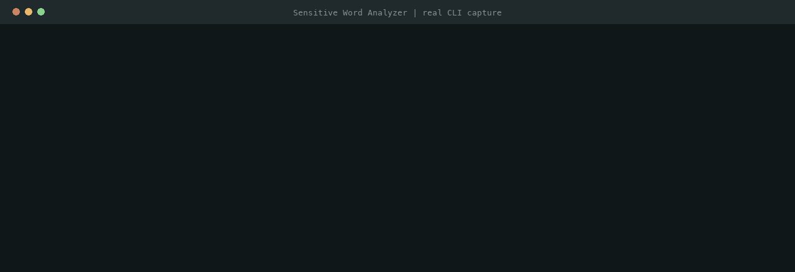
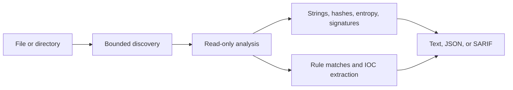

# Sensitive Word Analyzer

[](https://github.com/thurein2003/SensitiveWordAnalyzer/actions/workflows/ci.yml)
[](https://github.com/thurein2003/SensitiveWordAnalyzer/actions/workflows/codeql.yml)
[](https://www.python.org/downloads/)
[](LICENSE)

`swa` is a read-only static triage tool for suspicious files. It never executes or changes scanned files.

- Scans text and binary files with configurable rules.
- Reports hashes, entropy, file signatures, and extracted IOCs.
- Outputs readable text, JSON, or SARIF.
- Uses bounded reads and discovery to limit resource use.
- Runs on Python 3.9+ with no runtime dependencies.

## Install

```bash
pipx install git+https://github.com/thurein2003/SensitiveWordAnalyzer.git
swa ./path/to/file-or-directory --min-severity high
```

## Demo

From a source checkout, run this harmless example:

```bash
PYTHONPATH=src python3 -m sensitive_word_analyzer \
  examples/demo-sample.txt \
  --rules examples/custom_rules.json \
  --min-severity medium
```



The sample uses `example.invalid`; findings are signals for investigation, not verdicts.

## How it works



## References

[Architecture](docs/ARCHITECTURE.md) · [Rule authoring](docs/RULES.md) · [Security model](docs/SECURITY_MODEL.md) · [Changelog](CHANGELOG.md) · [Contributing](CONTRIBUTING.md) · [Security policy](SECURITY.md)

Run `swa --help` for all options. Use the tool only on files you are authorized to analyze.
